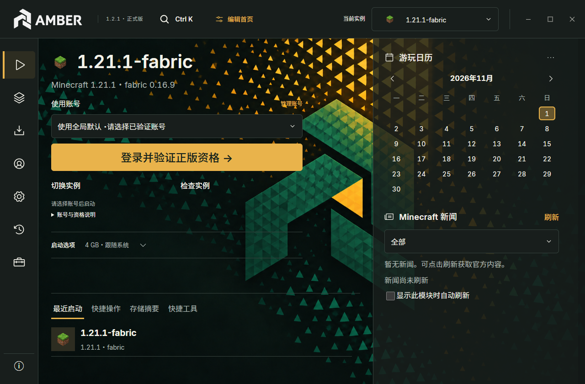
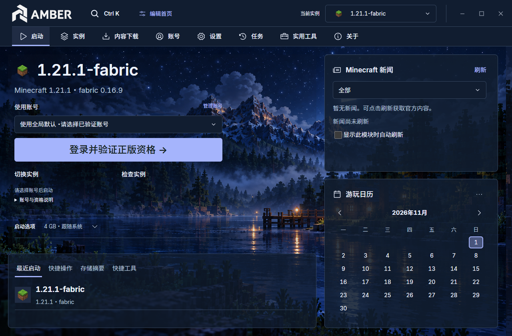

<h1 align="center">
  <picture>
    <source media="(prefers-color-scheme: dark)" srcset="prototype/public/brand/amber-lockup-reverse.svg" />
    
  </picture>
</h1>

<strong>Your world. Your way.</strong>

  
  
  
  

<a href="https://ayr1k.github.io/">Website</a> · <a href="https://ayr1k.github.io/#/download">Downloads</a> · <a href="docs/USER-GUIDE.md">User guide</a> · <a href="https://ayr1k.github.io/#/themes">Themes</a> · <a href="docs/zh-CN/README.md">简体中文</a>

An independent Minecraft: Java Edition launcher bringing instances, content, themes and server management into one workspace.

## Screenshots

<table>
  <tr><th>Alloy</th><th>Nocturne</th></tr>
  <tr>
    <td width="50%"></td>
    <td width="50%"></td>
  </tr>
</table>

Public AMBER 1.2.1 theme previews using demonstration data; these themes also work with AmberE. Click to enlarge. See the 1.7.0 notes below for current features and platform availability.

## Overview

AMBER is an independent launcher for Minecraft: Java Edition. It keeps game instances separate and brings installation, mod management, recovery and launch settings into one workspace. Project-owned source is licensed under MPL-2.0.

## 1.7.0

Choose the initial data location, manage multiple native or supported external game libraries, and use scoped component repair, pack upgrades and independent full-backup recovery. Fix hidden Windows game windows.

Windows/macOS/Linux/FreeBSD packages share version 1.7.0. Native macOS/Linux acceptance is pending; FreeBSD is experimental server/tools-only.

Windows x64 release with additional platform downloads. [Download the installer, source and checksums](https://github.com/ayr1k/amber-launcher/releases/tag/v1.7.0). Includes instance management, content recommendations, mod updates, backups and recovery.

- Integrated title bar, independent window corners, remembered window placement and reorganized privacy settings.

- Native Simplified Chinese and English, with instant language switching and importable text-only language packs.
- Vanilla, Quilt, Fabric, Forge, NeoForge, LiteLoader and OptiFine workflows with explicit compatibility checks. Support depends on the game version and official artifacts.
- Compatible Modrinth search, categories and sorting; selectable dependencies; mod updates, version locks and bulk content management.
- Local mod import, cross-version mod-list migration, content recovery history, instance backup and restore, recycle bin and guarded permanent deletion.
- Favorites, sorting, recent launches, instance checks, restart-resumable installation plans and data-location migration.
- Themes, square or rounded controls, custom layout, local backgrounds and adjustable launch-panel opacity.

## Install

Download the Windows x64 Setup executable from [Releases](https://github.com/ayr1k/amber-launcher/releases), verify its SHA-256 checksum and run it. The installer offers Chinese and English. Close games and AMBER before upgrading; retain backups of important worlds. Uninstalling the program does not automatically remove game data. The installer is unsigned.

## Account status

Minecraft API access for AMBER has been approved. Launch continues to verify eligibility. Approval is not an endorsement by Mojang or Microsoft. AMBER includes its public Microsoft Client ID. Login failure never silently switches to offline mode. AMBER requires online official eligibility verification for Microsoft and linked third-party launches. Explicitly created verified offline identities retain the official UUID, with an editable offline name with a maximum seven-day encrypted eligibility cache; this is a product policy, not a Mojang-approved exception. Legacy unverified offline accounts cannot launch in AMBER. Existing game instances and saves are preserved.

Third-party services require separate live validation. Offline mode does not grant Minecraft ownership or online-service access.

## Platforms and verification

Windows x64: EXE; macOS Intel / Apple Silicon: separate ZIPs; Linux x64: DEB. macOS needs device testing; Linux needs full desktop/keyring and gameplay testing. FreeBSD amd64 is an experimental server/tools bundle only. Packages are unsigned and macOS is not notarized. See [setup and limitations](prototype/PLATFORMS-1.3.5.md) and the [platform downloads](https://ayr1k.github.io/#/download).

## Documentation

- [User guide](docs/USER-GUIDE.md) / [使用指南](docs/zh-CN/USER-GUIDE.md)
- [Language packs](docs/LANGUAGE-PACKS.md) / [语言包制作](docs/zh-CN/LANGUAGE-PACKS.md)
- [Privacy](PRIVACY.md) / [隐私说明](docs/zh-CN/PRIVACY.md)
- [Security policy](SECURITY.md) / [安全政策](docs/zh-CN/SECURITY.md)
- [Release notes](CHANGELOG.md) / [更新日志](docs/zh-CN/CHANGELOG.md)
- [Testing and limitations](docs/TESTING.md) / [测试与限制](docs/zh-CN/TESTING.md)
- [Build and contribute](CONTRIBUTING.md) / [构建与贡献](docs/zh-CN/CONTRIBUTING.md)
- [Third-party notices](prototype/THIRD_PARTY_NOTICES.md) / [第三方声明](docs/zh-CN/THIRD-PARTY-NOTICES.md)

AMBER is not an official Mojang or Microsoft product. Minecraft, downloaded components and third-party projects retain their respective rights and licenses.

[Rollback guide](docs/ROLLBACK.md) / [回滚说明](docs/zh-CN/ROLLBACK.md)

## Product family

| Project | Purpose |
| --- | --- |
| [AMBER](https://github.com/ayr1k/amber-launcher) | Everyday use with Microsoft sign-in and eligibility verification |
| [AmberE](https://github.com/ayr1k/AmberE) | Offline and third-party identities; does not grant game ownership or authenticated server access |
| [AmberX](https://github.com/ayr1k/AmberX) | Experimental goal-based workflows, comparison and trials |

Each project uses separate data and update channels.

[Official theme store](https://ayr1k.github.io/#/themes) · [Theme help](docs/THEMES.md) · [Theme format](docs/AMBTHEME-FORMAT.md)

Alloy, Nocturne, Harvest and Verdant are free official themes for AMBER and AmberE 1.2.1 or newer, available separately and not preinstalled.

[Server and connection guide](docs/SERVERS.md) (remote rooms are a testing feature).

## Acknowledgements

This section thanks users whose suggestions have been accepted into the project. It will remain here for future accepted contributions of ideas and feedback.

- **Bilibili user @北目宁游戏 (UID 391446396)** — proposed letting a host select a modded environment and letting players confirm downloading the host's mods after joining the room. This inspired the room client environment synchronization introduced in 1.5.2.
- **Bilibili user @萨拉赫蒙-十恶不赦 (UID 2003495984)** — suggested memory optimization, inspiring the manual launcher-only memory optimization introduced in 1.6.0. Thank you for the idea!
- **Bilibili user @岩熵 (UID 1616300586)** — whose suggestions inspired the broader .minecraft game-library management and related features in 1.7.0, including data-location choices, external-library management and recovery. Thank you for the idea!
