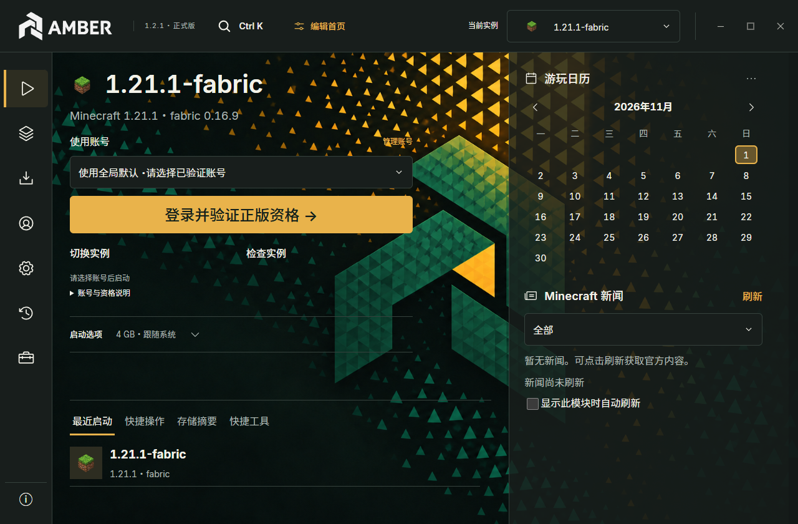
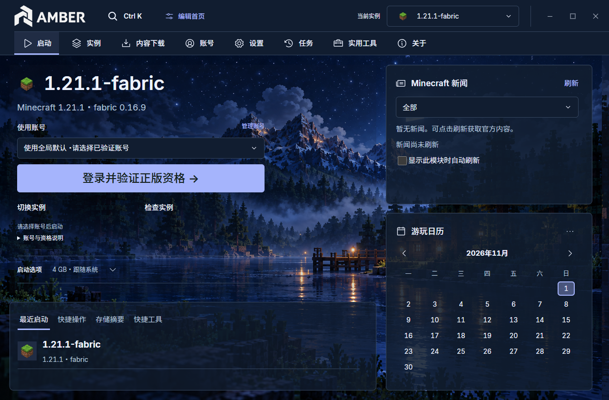

<h1 align="center">
  <picture>
    <source media="(prefers-color-scheme: dark)" srcset="../../prototype/public/brand/amber-lockup-reverse.svg" />
    
  </picture>
</h1>

<strong>你的世界，由你掌握。</strong>

  
  
  
  

<a href="https://ayr1k.github.io/">官网</a> · <a href="https://ayr1k.github.io/#/download">下载</a> · <a href="USER-GUIDE.md">使用指南</a> · <a href="https://ayr1k.github.io/#/themes">主题商城</a> · <a href="../../README.md">English</a>

独立的 Minecraft Java 版启动器，将实例、内容、主题和服务端管理集中在同一工作区。

## 软件截图

<table>
  <tr><th>Alloy</th><th>Nocturne</th></tr>
  <tr>
    <td width="50%"></td>
    <td width="50%"></td>
  </tr>
</table>

截图来自公开的 AMBER 1.2.1 主题展示，使用演示数据；主题同样适用于 AmberE。点击可查看大图，当前功能与平台范围以 1.7.0 说明为准。

## 项目简介

AMBER 是独立的 Minecraft Java 版启动器，将实例隔离、游戏安装、模组管理、恢复和启动设置集中在同一界面。项目自有源码采用 MPL-2.0。

## 1.7.0

支持首次启动选择数据位置、统一管理多个原生或受支持的外部游戏库，以及有明确范围的组件修复、整包升级和完整备份独立恢复，并修复 Windows 游戏窗口隐藏问题。

Windows/macOS/Linux/FreeBSD 均提供 1.7.0；macOS/Linux 待对应真机验收，FreeBSD 仅实验性服务端/工具。

提供 Windows x64 正式安装包及其他平台下载。[下载安装包、源码和校验文件](https://github.com/ayr1k/amber-launcher/releases/tag/v1.7.0)。支持实例管理、内容推荐、模组更新、备份与异常恢复。

- 一体化标题栏、独立窗口边框设置、窗口位置恢复与重新组织的隐私设置。

- 原生简体中文与英文，即时切换，支持导入纯文本语言包。
- 原版、Quilt、Fabric、Forge、NeoForge、LiteLoader 和 OptiFine 安装及显式兼容检查，实际支持取决于游戏版本和官方文件。
- Modrinth 兼容搜索、分类与排序，依赖选择、模组更新、版本锁定及批量管理。
- 本地模组导入、跨版本清单迁移、内容操作恢复、实例备份与恢复、回收站与受保护的彻底删除。
- 收藏、排序、最近启动、实例检查、安装任务跨重启继续和数据位置迁移。
- 主题、直角或圆角控件、自定义布局、本地背景及启动面板透明度。

## 安装

从 Release 下载 Windows x64 Setup 安装包，校验 SHA-256 后运行。安装器可选中英文。升级前退出游戏及 AMBER，备份重要存档。卸载程序不会自动删除游戏数据。安装器未进行代码签名。

## 账号状态

启动时继续验证游戏资格；这不代表 Mojang 或 Microsoft 官方背书。 AMBER 内置公开 Microsoft Client ID，认证失败不会静默切换离线身份。微软及关联的第三方账号在启动时在线验证官方资格；主动创建的已验证离线身份沿用官方 UUID，支持自定义离线名称，资格加密保存，最多缓存七天。这是产品策略，不代表 Mojang 已批准的例外。旧的未验证离线账号不能在主版启动；原有实例和存档仍保留。

第三方账号需单独进行真实服务验收。离线模式不授予游戏所有权或在线服务权限。

## 平台下载与验证范围

Windows x64：EXE；macOS Intel / Apple Silicon：独立 ZIP；Linux x64：DEB。macOS 尚未实机测试，Linux 尚需完整桌面/密钥库及游戏测试。FreeBSD amd64 仅为服务端与工具实验包。全部包未签名，macOS 未公证。查看[安装步骤与已知限制](../../prototype/PLATFORMS-1.3.5.md)及 [多平台下载页](https://ayr1k.github.io/#/download)。

## 文档

[使用指南](USER-GUIDE.md) · [语言包](LANGUAGE-PACKS.md) · [隐私](PRIVACY.md) · [安全](SECURITY.md) · [更新日志](CHANGELOG.md) · [测试](TESTING.md) · [贡献](CONTRIBUTING.md) · [第三方声明](THIRD-PARTY-NOTICES.md)

AMBER 非 Mojang 或微软官方产品。Minecraft、下载组件及第三方项目保留各自权利与许可。

[回滚说明](ROLLBACK.md)

## 产品系列

| 项目 | 定位 |
| --- | --- |
| [AMBER](https://github.com/ayr1k/amber-launcher) | 日常使用，Microsoft 登录与正版资格验证 |
| [AmberE](https://github.com/ayr1k/AmberE) | 离线和第三方认证；不授予游戏所有权或正版服务器权限 |
| [AmberX](https://github.com/ayr1k/AmberX) | 目标式操作、方案比较与试用体验的实验项目 |

三个项目的数据目录和更新渠道独立。

[官方主题商城](https://ayr1k.github.io/#/themes) · [主题使用帮助](THEMES.md) · [主题格式规范](AMBTHEME-FORMAT.md)

Alloy、Nocturne、Harvest 与 Verdant 均为独立下载的免费官方主题，适用于 AMBER 和 AmberE 1.2.1 及以上版本，不预置在软件内。

[服务端与联机指南](SERVERS.md)（异地房间为测试功能）。

## 鸣谢

本栏目长期用于感谢向项目提出建议且建议被采纳的用户，后续会持续补充。

- **B 站用户 @北目宁游戏（UID 391446396）**：提出“房主选好模组，其他玩家进入房间后确认下载房主模组”的建议，启发了 1.5.2 的房间客户端环境同步功能。感谢提供创意！
- **B 站用户 @萨拉赫蒙-十恶不赦（UID 2003495984）**：提出内存优化建议，启发了 1.6.0 的启动器手动内存整理功能。感谢提供创意！
- **Bilibili 用户 @岩熵（UID 1616300586）** — 其建议启发了 1.7.0 对 .minecraft 游戏库的全面管理支持及相关功能，包括数据位置选择、外部库管理与恢复。感谢提供创意！
