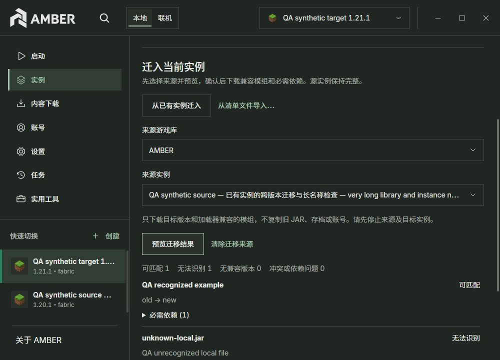
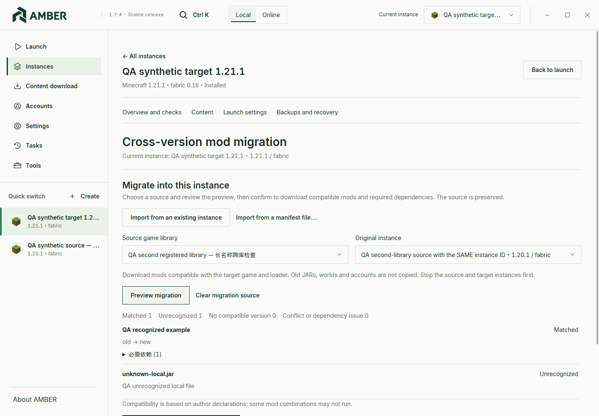
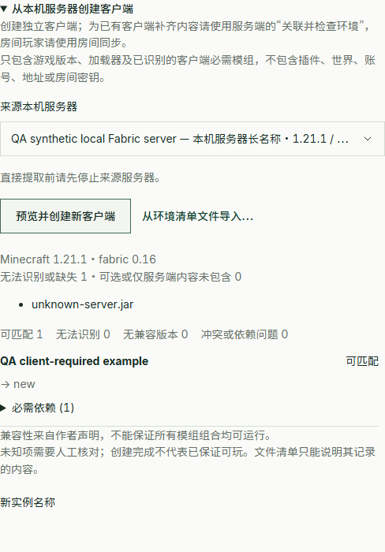

# 1.7.4 formal release / 正式发布

PR #19 merged as `3bcc073f8ef8498d32d738f31340bf8b8930942b`; final accepted task head `12f56dcbb71cbc4d656dedb71476faba5729d1cc`. The user authorized formal publication on 2026-11-16 (America/New_York). Official packages use **1.7.4/public**. The earlier P2 cancellation race at `14df49a` was fixed and independently retested by AriaXiaoLan at the final head: 21 transfer tests passed, including all four gated cancellation paths, and the original reproduction now rejects as cancelled. Final CI runs 44012493500 / 44012493577 passed. Full 929-test results are developer/CI evidence, not an independent full rerun. Independent packaged smoke was blocked by Windows ACL access and did not pass; developer and CI startup are separate evidence. Review-time stale delivery lists were historical; the current PR separates final local/CI hashes. This formal release creates fresh source manifests, provenance and checksums from the approved merged state.

用户已批准合并并授权正式发布。更早 P2 取消问题已在最终提交独立复测确认修复，不把旧测试包或旧清单作为本次依据。下方 Draft／本地渠道／等待审核等保留历史阶段；既有界面截图证明原界面，新增 gated 测试证明修复后的取消时序。独立成品复验因 ACL 受阻，不能记为通过；开发／CI 与本次正式成品检查分别记录。本会话不重复内容审核；真实游戏组合、登录、跨设备房间、安装升级／回滚、第三方主题、物理 DPI 和非 Windows 原生验收仍保留原限制。

# 1.7.4 task validation / 任务验证

Base: latest main `f0002a1`. Branch: `codex/1.7.4-direct-transfer`. Existing local task repositories were clean; the parent workspace contained untracked historical material and was left intact. Both products had no duplicate open PR. A separate checkout protects existing work. Installer artifacts record the exact tested commit and clean-source provenance; source commits exclude installers, dependencies, caches, game data and credentials.

基于最新 main 独立开发，未改变既有工作、真实账号／游戏库、七款商城主题或 AmberX。此记录属于开发验证；独立审核在 `14df49a` 发现下述取消竞态，本次修复后等待小岚复审和用户人工验收。没有合并、正式发布或官网部署。

## Cancellation handoff fix / 取消竞态修复

The review reproduced creation continuing after cancellation while the final `withLibrary` call awaited `libraries170.entry`. The transfer controller was already aborted, but no workflow scope existed yet for `workflows.cancel` to stop. Both `run` and `create` now recheck the signal inside that final callback, immediately before calling the workflow, with no intervening await. The normal workflow cancellation handles requests after its scope is established. The library-acquisition adapter in `main.mjs` and its existing identity checks are preserved.

已先用确定性的异步暂停点复现旧实现：默认库创建从 **2 → 3** 个实例，安装 **1** 项，结果未取消；已有目标迁移同样继续安装。回归测试在完成所有预检后暂停最终 `registry.entry`，按真实入口顺序调用 `workflows.cancel` 和 `service.cancel`，再释放查询。修复后操作以取消错误拒绝，不会建立工作流或产生迁移报告。

| Path / 路径 | Target library / 目标库 | Instances across both libraries / 两库实例数 | Installed / 安装 | Source and existing target / 数据 |
| --- | --- | --- | --- | --- |
| Existing target / 现有目标迁入 | Default / 默认库 | 2 → 2 | 0 | Unchanged / 未改动 |
| Existing target / 现有目标迁入 | Second managed / 第二管理库 | 3 → 3 | 0 | Unchanged / 未改动 |
| New instance / 新建并迁移 | Default / 默认库 | 2 → 2 | 0 | Unchanged / 未改动 |
| New instance / 新建并迁移 | Second managed / 第二管理库 | 2 → 2 | 0 | Unchanged / 未改动 |

The tests exercise the real workflow/content fixture, not a no-op replacement. They assert zero workflow dispatches, instance creations, content installs and jobs; hash the complete synthetic source tree including mods, configuration and world bytes; and verify the existing target tree and both libraries' instance records remain unchanged. Two new regression groups cover four library/path variants. All **37 related tests** and the full **929-test regression suite** passed after the fix, with no failures or skips. Production build, four static-worker checks, 3286 bilingual messages/placeholders, source/license and diff checks passed. Paired-installer, provenance and SHA-256 results are recorded against the updated PR head and its downloadable artifacts.

## Coverage / 覆盖

- `tests/transfers174.test.mjs`: **17 regression groups / 21 test nodes**, including four new final-acquisition cancellation variants, covering direct/file parity, independent libraries and instance identities, physical aliases/self-targets, running instances, linked content, compatibility, required dependencies, unknown content, unmanaged-file conflicts, cross-root conflicts, preview invalidation/replay, remote metadata changes, cancelled previews, preflight cancellation, partial failures, disabled roots, shared-target acknowledgement and retained/retried setup.
- Server coverage uses the existing requirements extractor, dependency resolver and creation workflow, including unknown/missing declarations, plugin exclusion, immutable source checks, exact versions, file diagnostics and privacy allowlists.
- Initial head `14df49a`: **923 Windows regressions passed, 0 failed, 0 skipped**, but those tests did not cover the review's final-acquisition cancellation window. This fix adds the missing cases. Four static-worker tests, **3286 bilingual messages/placeholders**, production build and source/license checks are also required. The local build uses the locked Vite runner directly after a pnpm cache-path recheck limitation. Native-memory/identity and paired packaged-startup/provenance results are delivered with installer evidence.
- `scripts/qa-transfers174.cjs`: **12 checks/configurations passed**, zero renderer errors. It drives the real Electron renderer and IPC with isolated synthetic data. It checks both direct paths and both file paths, source/library changes, cancellation, creation, visible migration summaries, long names, English/Chinese, light/dark and 1366/1000 pixel windows. Screenshots are actual interface captures. Component crops exclude unrelated local path labels. A further **4 focused UI scenarios passed** after making source selectors wait for their lists and preserving state when reselecting the current library.

Historical UI evidence: AmberE staged application files from `2ac57e8` passed the full **12-case UI matrix**, with zero renderer errors; `14df49a` only stabilized that QA driver and added evidence. The cancellation fix changes backend dispatch only. These existing screenshots continue to document the unchanged interface; they are not evidence that the newly identified race had been tested before the review. Updated installer provenance and CI results are attached to the PR head.

## Screenshots / 实际截图

## Limits / 限制

Remote projects/JAR bytes and Java/game setup primitives are synthetic. These checks establish application behavior, file boundaries and installation transactions, not a real game installation or gameplay acceptance. Installer startup is separate from running an installer/upgrading a user's existing installation. Live account/ownership policy, cross-device rooms, real mod combinations, third-party themes, physical DPI and native non-Windows runtime remain unverified for this task. The build retains its existing large-chunk advisory. Unknown server content is disclosed rather than claimed to be automatically playable.

界面截图和测试数据均为明确标注的合成夹具；不读取真实令牌或世界。成品启动不能代替用户实际安装升级验收；未知内容和真实兼容性仍需人工核对。安装身份与数据位置关系见 [测试安装包说明](../LOCAL-TEST-1.7.4.md)。
