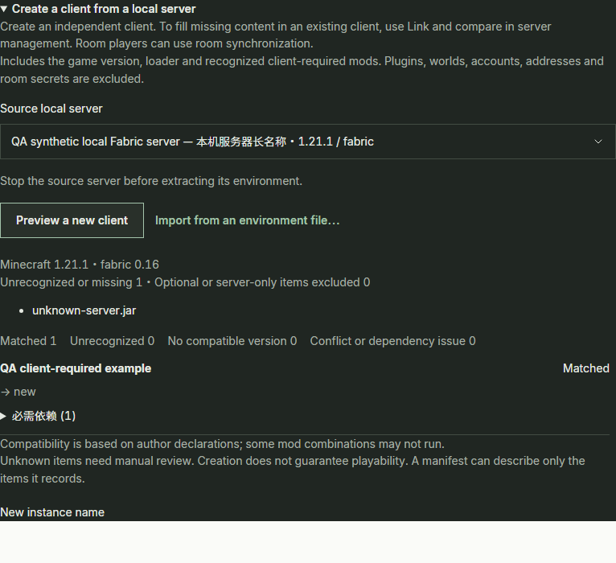
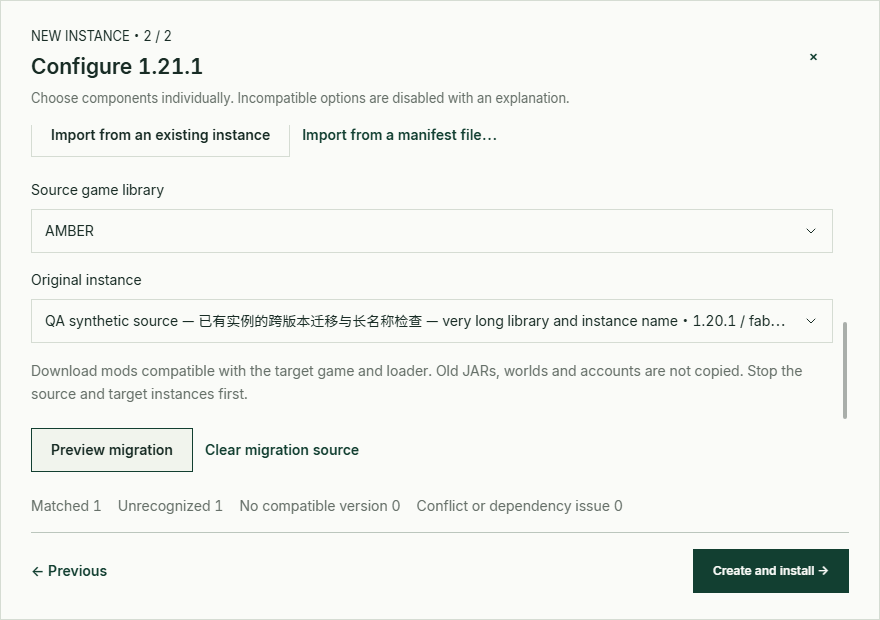
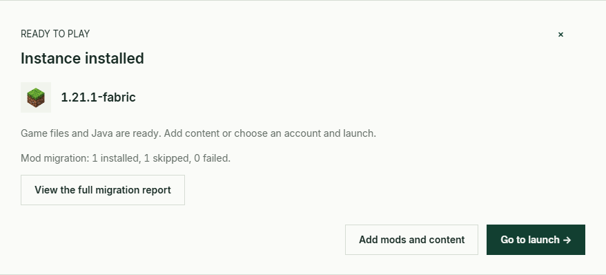
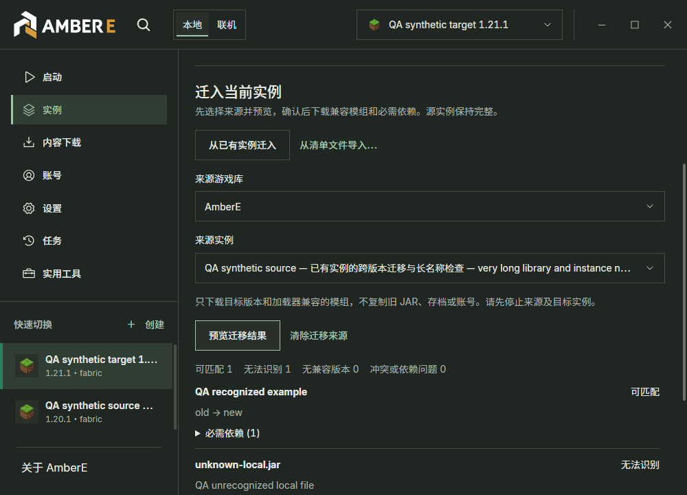

# 1.7.4 task validation / 任务验证

Base: latest main `f0002a1`. Branch: `codex/1.7.4-direct-transfer`. Existing local task repositories were clean; the parent workspace contained untracked historical material and was left intact. Both products had no duplicate open PR. A separate checkout protects existing work. Installer artifacts record the exact tested commit and clean-source provenance; source commits exclude installers, dependencies, caches, game data and credentials.

基于最新 main 独立开发，未改变既有工作、真实账号／游戏库、七款商城主题或 AmberX。此记录属于开发验证；独立审核和人工验收尚待小岚及用户完成。没有合并、正式发布或官网部署。

## Coverage / 覆盖

- `tests/transfers174.test.mjs`: **15 focused tests** covering direct/file parity, independent libraries and instance identities, physical aliases/self-targets, running instances, linked content, compatibility, required dependencies, unknown content, unmanaged-file conflicts, cross-root conflicts, preview invalidation/replay, remote metadata changes, cancelled previews, preflight cancellation, partial failures, disabled roots, shared-target acknowledgement and retained/retried setup.
- Server coverage uses the existing requirements extractor, dependency resolver and creation workflow, including unknown/missing declarations, plugin exclusion, immutable source checks, exact versions, file diagnostics and privacy allowlists.
- **923 Windows regressions passed, 0 failed, 0 skipped**; four static-worker tests, **3286 bilingual messages/placeholders**, production build and source/license checks passed. The local build used the locked Vite runner directly after a pnpm cache-path recheck limitation. Existing native-memory/identity checks passed (7 identity/exit/permission cases plus an isolated native Electron process). Paired packaged-startup/provenance checks are delivered with installer evidence.
- `scripts/qa-transfers174.cjs`: **12 checks/configurations passed**, zero renderer errors. It drives the real Electron renderer and IPC with isolated synthetic data. It checks both direct paths and both file paths, source/library changes, cancellation, creation, visible migration summaries, long names, English/Chinese, light/dark and 1366/1000 pixel windows. Screenshots are actual interface captures. Component crops exclude unrelated local path labels. A further **4 focused UI scenarios passed** after making source selectors wait for their lists and preserving state when reselecting the current library.

AmberE staged application files from `2ac57e8` also passed the full **12-case UI matrix**, with zero renderer errors. The final follow-up only stabilizes the QA driver by waiting for form scrolling to settle before opening a popover; it does not change application files. Final installer provenance and CI results are attached to the PR head.

## Screenshots / 实际截图

## Limits / 限制

Remote projects/JAR bytes and Java/game setup primitives are synthetic. These checks establish application behavior, file boundaries and installation transactions, not a real game installation or gameplay acceptance. Installer startup is separate from running an installer/upgrading a user's existing installation. Live account/ownership policy, cross-device rooms, real mod combinations, third-party themes, physical DPI and native non-Windows runtime remain unverified for this task. The build retains its existing large-chunk advisory. Unknown server content is disclosed rather than claimed to be automatically playable.

界面截图和测试数据均为明确标注的合成夹具；不读取真实令牌或世界。成品启动不能代替用户实际安装升级验收；未知内容和真实兼容性仍需人工核对。安装身份与数据位置关系见 [测试安装包说明](../LOCAL-TEST-1.7.4.md)。
